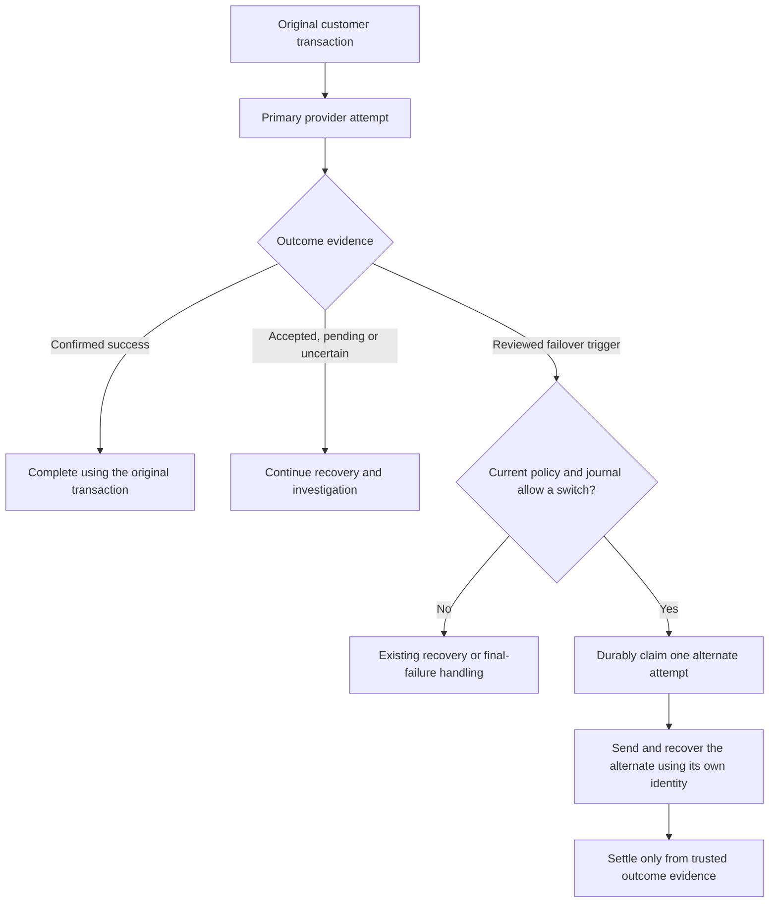

# Managing provider failover

This is the team operating guide for payout and recharge failover. It covers the current task-based dashboard and the backend integration contracts in the sibling backend checkout. Newer backend conveniences that are not exposed in this dashboard are identified separately below.

## 1. The mental model

**One customer transaction, one original quote/debit, and at most one alternate provider attempt.**

An attempt is an external provider request with its own recorded identity. It is not another customer purchase. The journal remembers every attempt so a restart, callback, policy change or repeated request cannot authorize an extra payment.

Failover is permission to use a specific backup after specific evidence. An enabled switch does not make every failed, slow or pending transaction eligible.

For a new alternate claim, all of these must agree:

1. The current published policy permits claims and the infrastructure emergency switch is off.
2. The original transaction is after the creation cutover and belongs to the rollout cohort.
3. An enabled directional rule matches its actual route or exact product.
4. The source produced the reviewed failure evidence for that system.
5. Route/product, account, recipient, funding and original-quote checks still pass.
6. The journal permits the claim: no previous alternate, uncertainty, conflicting success or refund reservation blocks it.

**Unknown does not mean unpaid.** Timeouts, missing lookups and queued requests cannot justify a second provider request. Evidence that the provider accepted a request is also different from evidence that it completed delivery.

Pausing failover leaves normal payment processing and recovery running. It prevents new managed claims; an alternate already durably claimed may still be sent and finish.

## 2. Choose the correct system

The policies are independent. Enabling or pausing one does not change the other.

| | Payout failover | Recharge failover |
| --- | --- | --- |
| Menu | **Payout failover**, also linked from **Payments** | **Recharge failover**, also linked from **Payments** |
| Page | `/dashboard/payout-failover` | `/dashboard/recharge-failover` |
| Direction | pawaPay → Maplerad only | RELOADLY → ZENDIT or ZENDIT → RELOADLY |
| What a rule maps | Two routes for the identical mobile-money method, with compatible wallet/Business API payout actions | Two inspected, equivalent FIXED direct-delivery AIRTIME, DATA or BUNDLE products |
| Trigger | A correlated, synchronous rejection with a reviewed code | Verified terminal non-delivery with a reviewed source-specific condition |
| Attempt limit | Primary plus one alternate | Primary plus one alternate, using distinct providers |
| Preview | Configuration only, a sample payout, or an existing transaction | An existing transaction only; may read provider catalogs |
| On-demand provider check | **Read latest provider evidence**, observational only | No manual status-check action in this screen; inspect recorded recovery observations |

Recharge supports an existing legacy-account or fiat-wallet debit. External collections, loan funding, crypto-wallet funding, RANGE products and PIN/redemption products retain their existing path.

These controls do not turn on Business API LIVE acceptance, bypass account restrictions or change the ordinary primary-provider routing policy. The Business API sandbox history page is an inspection tool, not a live failover activation or test control.

### Access

| Role | Inspect, preview and investigate | Publish, enable, resume and pause |
| --- | --- | --- |
| `SUPER_ADMIN` | Yes | Yes |
| `ADMIN` | Yes; includes payout evidence checks and local recharge preview drafts | No |
| `ASSISTANT`, `STAFF`, customer or anonymous | No | No |

Backend authorization remains authoritative, including database-role verification for protected operations. Both screens are hidden in regulator-mode dashboard presentation.

## 3. Understand what is saved

There are three different things on the page:

| Thing | Meaning | When it changes payments |
| --- | --- | --- |
| Local draft | Your unsaved rules, cohort and proposed configuration | Never by itself; navigation/reload can lose it |
| Published policy | Complete configuration stored under a revision | On successful publication; publishing an enabled configuration is a live change |
| Effective switch | Configured enabled value, subject to infrastructure suppression | Allows claims only when every transaction-level condition also passes |

**Publish replaces the whole configuration**, including ordered rules, account IDs, enabled value and cutover. It is not a partial rule update. Every retained rule must be included. A publication reason and the last-read `expectedRevision` are required.

**Enable/resume and pause use the saved rules and cohort. They do not publish your unsaved editor changes.** The dashboard preserves a separate dirty draft across these actions. Review or discard that draft before publishing again, especially after a pause, so an old draft cannot accidentally restore an earlier enabled value or cohort.

Other policy concepts:

- **Rollout account IDs:** customer account IDs, not Business IDs, API-key IDs or admin IDs. A blank list means **all otherwise eligible accounts**, not an empty pilot. Maximum: 1,000 IDs.
- **Rule order:** rules are evaluated in array order, independently of primary-provider rank. Keep the intended precedence when reordering. Maximum: 100 rules.
- **Stable rule ID:** keep it when editing the same rule; attempt history uses it to explain a selection. A reverse recharge mapping is a separate directional rule.
- **Rule enabled:** determines whether that saved rule can participate. A globally enabled policy with no enabled matching rules cannot switch a transaction.
- **Cutover:** a boundary on the original transaction's creation time, not the time its provider error arrives.
- **Cutover floor:** the established boundary cannot be moved backwards to adopt historical or paused-period transactions.

For payouts, `DEPLOYMENT` revision `0` means no admin policy has been published yet. The normal default is off. After the first publication, `DATABASE` becomes authoritative across upgraded web/worker processes without a cache TTL or redeploy. Editing deployment route settings then does not replace the published database policy.

## 4. Before the first rollout

Have engineering confirm the matching backend release and migrations are deployed on **every web and worker process**, before choosing the future cutover:

| System | Backend schema requirements |
| --- | --- |
| Payout | `20261207_payout_failover_journal.sql`, then `20261208_payout_failover_admin.sql`; the current backend contract also requires `20261209_payout_failover_refund_fence.sql` |
| Recharge | `20261211_recharge_failover.sql` |

Refresh capabilities and saved policy in the intended environment. Confirm the current revision, configured/effective state and any emergency suppression. No migration, dashboard build or documentation change enables a production policy.

Use real active routes/products from that environment. Check provider credentials, applicable recipient/corridor restrictions and funding readiness. Local validation and a successful preview do not certify current provider funds, commercial fees or a future external outcome.

Start with an explicit small account cohort. For recharge, begin with reviewed fixed airtime before expanding to DATA/BUNDLE or a reverse direction.

Both pages open on **Overview**, which shows the saved on/off/scheduled state, enabled rule count, covered accounts and a three-step guide. Use the same sections on either page:

| Section | Use it to |
| --- | --- |
| Overview | Understand the saved state and activity counts |
| Backup setup | Prepare route/product pairs, choose accounts and save the full configuration |
| Turn on / pause | Activate the saved setup for a future creation time, or pause new attempts |
| Payment activity | Search tracked payments and investigate each provider attempt |
| Change history | Read previous saved versions, their author and reason |

Question-mark controls open explanations on click or keyboard activation. Advanced fields, technical identifiers, full configuration JSON and preview tools are collapsed until needed. Switching sections keeps local drafts.

## 5. Set up payout failover

1. Open **Payout failover → Backup setup**. Refresh saved policy and route catalog; note the saved revision and source.
2. In **Configure payout backups**, prepare the setup with backups off. The draft enabled value is under **Advanced: enabled value and creation boundary in this draft**. Enter the pilot account IDs explicitly.
3. Select **Add a backup route pair**. Choose a real pawaPay source route and a Maplerad target for the identical mobile-money method. Check the country/operator, currency, supported payout action and active states.
4. Select only the applicable rejection codes offered by capabilities. The current allowlist is `PROVIDER_TEMPORARILY_UNAVAILABLE` and `PAWAPAY_WALLET_OUT_OF_FUNDS`. Leave the generated stable ID intact; use the rule name for an operator-friendly description.
5. Review every rule and its order. Enter a meaningful **Reason for this setup change**, then **Save backup rules**. Confirm the returned revision and paused saved state.
6. Use **Test your payout setup without sending payments** to validate the configuration and, when needed, test a sample using the recipe below. Resolve validation errors before activation; review warnings such as an unrestricted cohort.
7. Open **Turn on / pause**, enter **Start for payments created after (UTC)** and **Reason for turning on or pausing**. Choose **Turn on payout backups**. Confirm a newer saved revision, the intended cutover and the enabled saved state (or **Scheduled** on Overview when the start is in the future).
8. Reconcile or discard any remaining local preview draft against the new saved revision. Monitor **Payment activity** as new, eligible payouts arrive through the normal flow.

Only reviewed synchronous source rejections can switch. Customer insufficient balance, a generic HTTP failure, an accepted/enqueued payout, a timeout or an unknown outcome cannot trigger Maplerad. The payout must satisfy the whole-unit, same-currency, unchanged-quote and destination-funding constraints. An account-specific provider route remains a constraint even when the account is in the pilot.

### Preview a planned activation without publishing it

Use a local draft that represents the intended enabled policy and future cutoff. Select **Unsaved setup draft**, **An example payout (no money sent)**, a reviewed rejection code, and a sample creation time **after** that cutoff. Supply a real sample account/source route, supported action, recipient and amounts.

Changing the draft enabled checkbox for this preview does not activate the saved policy. Do not publish that temporary draft merely to run the preview. The dedicated enable action later uses the saved policy and its separately entered activation cutoff.

Interpret the result correctly:

- **Configuration validation only** does not evaluate transaction eligibility; `eligible` can be null.
- A saved paused policy will report disabled when its eligibility is evaluated. That is expected.
- Choosing a rejection code additionally evaluates the alternate destination.
- **Eligible under local checks** is not a provider-balance or delivery guarantee. Preview sends no payout and creates no attempt.
- An already-attempted, old, terminal, referenced or otherwise ineligible existing transaction does not become replayable through preview.

## 6. Set up recharge failover

1. Open **Recharge failover → Backup setup → 1. Review product pair**. Choose the country/type and a direction: primary and backup must be different supported providers.
2. Supply the real product identifiers and fixed supplier amounts. Reloadly uses an operator ID and fixed sender denomination; Zendit uses an offer ID and its current fixed catalog supplier cost.
3. Select **Inspect primary product** and **Inspect backup product**. These calls read provider terms and produce approval fingerprints; they do not buy anything. Reinspect after changing inputs. A previous inspection is unusable after a failed replacement inspection.
4. Review both term snapshots. Enter the same real **Real network name**, write the benefits/eligibility review, choose an approval expiry, set the maximum additional supplier cost and select the reviewed source failure conditions. Explicitly confirm equivalent benefits and eligibility.
5. Select **Add reviewed pair to setup draft**. This only copies the approved pair into the local editor. An Admin can prepare a preview draft, but only a Super Admin can publish it.
6. Open **2. Save pairs & accounts**. Keep the global draft disabled, enter the pilot account IDs, review mapping order and flags, and **Save recharge backup rules** with a reason. Confirm the returned paused revision.
7. Use **Check an existing recharge without sending a purchase** where a real transaction is available. It can evaluate the saved policy or local draft but never purchases, enrolls, settles, refunds or clears a guard.
8. Open **Turn on / pause**, set **Start for purchases created after (UTC)** and a reason; choose **Turn on recharge backups**. Confirm the new revision, effective switch and cutover. Review/discard any retained local draft, then monitor new normal-flow purchases in **Payment activity**.

### What counts as equivalent?

| Review | Requirement |
| --- | --- |
| AIRTIME | Delivered amount and delivered currency match exactly |
| DATA/BUNDLE | Equivalent data, duration, voice/SMS, fair-use/unlimited terms, time restrictions, prepaid/recipient eligibility, taxes, activation and promotions |
| Both | Same real network and compatible restrictions; source and target supplier currencies match |

A 5 GB seven-day plan is not equivalent to a 5 GB thirty-day plan. Similar names and prices do not approve a product. The backend cannot establish complete DATA/BUNDLE equivalence from those alone.

`maxAdditionalCost` limits the increase in fixed supplier purchase amount in the common currency. For an illustrative source cost of 5.00 and a ceiling of 0.10, a target cost of 5.08 passes that price ceiling; 5.11 does not. All other checks still apply. A zero ceiling is valid. This is not a net-profit calculation: review provider fees and discounts separately. The customer's original quote and debit remain unchanged.

Fingerprints are opaque snapshots of provider metadata, including pricing and terms. Keep the returned values unchanged. Changed fingerprints, expired approval or an unavailable destination catalog prevent use until the required inspection/review succeeds. Do not edit a fingerprint or round an approved product amount to make a mapping pass.

### Reviewed recharge triggers

| Source | Required evidence |
| --- | --- |
| RELOADLY | Correlated authenticated API read-back of terminal `REFUNDED` |
| ZENDIT | Correlated terminal `FAILED` with `INSUFFICIENT_FUNDS`, `NO_INVENTORY`, `OFFER_UNAVAILABLE` or `PROVIDER_UNAVAILABLE` |

Use the current `/capabilities` allowlist. An insufficient-balance HTTP response from Reloadly, an error message containing one of these strings, a duplicate ID, a balance precheck or a missing lookup is insufficient evidence. Zendit `IN_PROGRESS` may still be queued for provider retries and cannot switch. Callback bodies trigger verification; they do not independently authorize purchase, completion or refund.

Recharge preview has no synthetic future sample. An existing transaction created before the proposed cutoff can legitimately be ineligible. A permanent legacy decision cannot be adopted by later rules or activation, and `alreadyManaged` means inspect its existing operation. Do not interpret either result as permission to restart the purchase.

## 7. Pause, resume and change scope

To stop new claims, use **Pause payout backups** for payouts or **Pause recharge backups** for recharge, with an incident/change reason. Confirm the returned saved state and revision. Pause preserves rules and rollout accounts and does not require current route/catalog readiness.

Pausing does not cancel or refund a transaction, release held funds, undo an attempt, stop callbacks or disable recovery protections. Keep workers and investigation running. An already-claimed provider request may still be sent after pause.

Resume with a **new future UTC cutoff** that respects the floor. For example:

| Time (UTC) | Action/event | Meaning |
| --- | --- | --- |
| 10:00 | Activate with cutoff 10:05 | Transactions created before 10:05 remain excluded |
| 10:06 | A matching new transaction is created | It may qualify if all remaining conditions pass |
| 10:08 | Pause | No new managed claims; already-claimed work can continue |
| 10:09 | Another transaction is created during the pause | Pausing does not adopt or resend it |
| 10:12 | Resume with cutoff 10:15 | The 10:09 transaction remains excluded by the new cutoff |
| 10:16 | A matching new transaction is created | It may qualify under the resumed policy |

When expanding a cohort, keep rules, directional approvals and cost limits intact; publish the complete reviewed configuration with a reason. An enabled publication is immediately authoritative for subsequent checks. To stage a change without permitting new claims, pause first and publish a disabled policy.

To remove one mapping from future selection, disable that rule and publish; the other enabled rules can keep operating. Removing/reordering a rule never resets an existing attempt.

### Concurrent edits and restoring earlier settings

On `409`, retain the local draft and refresh the saved policy. Compare the newer revision, enabled value, cutoff, cohort and every rule before choosing to keep/rebase your draft or replace it with the saved configuration. Do not blindly overwrite a colleague's pause or rollout change.

History is immutable. To return to an earlier set of rules, copy the intended settings into a draft based on the **latest** revision and publish a new revision. Preserve current cutover constraints; if resuming, choose a new future cutoff. Restoring rule settings never replays payments or rewinds attempt guards.

## 8. Investigate an operation

Start with the original transaction ID/reference. Inspect **all attempts**, including the source after a switch, and open the recorded rule/revision in history to understand the decision.

| Signal | Interpretation and next step |
| --- | --- |
| Payout `RETURNED` | Submission evidence, not settlement confirmation; inspect terminal evidence and provider records |
| Lookup `FOUND` | A matching lookup payload was found; inspect its actual provider status |
| `NOT_FOUND`, `UNVERIFIABLE`, `ERROR`, `UNSUPPORTED` | No authority to release funds, refund or submit another provider request |
| Recharge `UNKNOWN` / `IN_PROGRESS` | Outcome unresolved; continue recovery/investigation |
| Recharge `NOT_DELIVERED` | Check the correlated source-specific evidence and every other policy/journal condition |
| Conflict or contradictory success | Investigate every attempt through the reviewed reconciliation process; no resend or forced refund |
| `refundReserved` | A fence against further dispatch, not proof the wallet was credited; verify the original refund transaction/`refundedAt` |
| Missing failover journal (`404`) | No recorded managed operation was found; it does not prove the original transaction failed |

### Payout evidence checks

In **Payment activity**, investigate a transaction and use **Read latest provider evidence**. It uses recorded identities, including the original pawaPay UUID after a route change. It records observations and an audit event without submitting, refunding, settling or automatically reconciling money.

The cooldown is 30 seconds per transaction across all admins/processes. On `429`, wait for the cooldown rather than repeatedly clicking. pawaPay lookup is supported; Maplerad live lookup is currently `UNSUPPORTED`. Use recorded signed callbacks and the provider's operational records for that side. Do not treat an old submit/callback summary as a fresh provider query.

Do not substitute the generic transaction **momo-status** action: that existing action can trigger fulfillment. The failover-specific check is the observational tool.

Newer payout backend responses also expose terminal evidence and a refund reservation fence; this dashboard version does not render every added field. Use the existing transaction investigation and approved backend evidence tools when fuller evidence is needed. A matching status observation of `COMPLETED` blocks unsafe refunds/alternate claims; the observation does not itself reconcile the transaction.

### Recharge recovery

Open the operation and its original quote/funding, current attempt, references, query counts and sanitized observations. The dashboard has no manual provider-check, resend, journal-reset or refund action for recharge.

Durable recovery schedules reads with backoff from 5 seconds to 15 minutes, up to 128 scheduled reads per attempt. Exhaustion leaves the outcome unresolved and flags manual review; it does not mean non-delivery or authorize a new purchase/refund. Manual completion also requires matching delivery proof. A late source failure cannot fail/refund its alternate; contradictory source success freezes dispatch and refunds for investigation.

### Refund boundary

Pausing does not relax refund protection. Pending, unknown, successful or conflicting attempts block unsafe negative status changes/refunds. All attempts need conclusive non-payment evidence before final failure/refund can proceed through the existing reviewed process. For managed Maplerad payouts, the current backend recognizes a matching signed `transfer.failed` callback with explicit `FAILED` status as automatic non-payment evidence; a generic submit error or reversal alias is insufficient.

Do not change an amount, currency, fee, recipient or funding wallet to force completion; the original financial snapshot remains authoritative. Do not clear guards, manually resend, or treat `refundReserved` as a customer credit.

## 9. Monitor and handle common problems

After activation and during operation, review the effective switch, cohort, rules and new attempt evidence. For recharge, also review approval expiry and changed product terms before continuing a mapping.

| View | Scope and interpretation |
| --- | --- |
| Payout overview | Default last seven days; UTC query window up to 90 days. Review alternate claims/completions, final failures, unresolved/conflicted and aged unresolved cases |
| Recharge overview | Last 30 days. Review operations, alternate claims, conflicts, unresolved and refund reservations |
| Both | Counts, not monetary totals or a success guarantee. Inspect the original transaction and all attempts for the actual outcome |

Payout final failures and unresolved cases can overlap when a manual refund remains outstanding. Do not add those counts as disjoint categories. Recharge `refund_reserved` does not count proven wallet credits.

| Problem | What to check/do |
| --- | --- |
| Menu missing or write buttons unavailable | Verify admin role, regulator presentation, saved-state loading and whether the action requires Super Admin |
| Configured enabled but effective off | Inspect infrastructure emergency suppression; the dashboard cannot bypass it |
| `POLICY_DISABLED` / `BEFORE_CUTOVER` / `ACCOUNT_NOT_IN_ROLLOUT` | Check saved state, original creation time and account ID; do not backdate a cutoff to adopt an old transaction |
| `ACCOUNT_PROVIDER_OVERRIDE` / `WHOLE_UNIT_AMOUNT_REQUIRED` | Respect account routing and payout denomination constraints; changing the pilot list does not bypass them |
| `NO_ENABLED_RULE` / `NO_ELIGIBLE_ALTERNATE` / `ROUTE_PREFLIGHT_UNAVAILABLE` | Check rule order, exact source, active compatible destination, currency and actual recipient eligibility |
| `REJECTION_CODE_NOT_REVIEWED` or a timeout | There is no permitted trigger. Preserve the existing attempt and investigate its outcome |
| `PAYMENT_SNAPSHOT_CHANGED` / already refunded or attempted | Inspect the original transaction and journal; do not reset data to obtain eligibility |
| Recharge terms changed/approval expired | Reinspect, review and publish a new approved snapshot; preserve the mapping ID when editing the same rule |
| Long-running uncertainty or conflicts | Inspect every attempt; pause the relevant policy if new claims should stop while the issue is investigated |
| `400` / `409` / `429` | Correct validation / review the newer revision / wait for the evidence-check cooldown, respectively |
| Network or `5xx` during a policy write | The UI retains last-confirmed state. Refresh saved policy/history to determine whether it committed before retrying |

Record transaction IDs, provider references, policy revision/rule ID, current evidence and any pause/review decision in the team's incident/change record. Use **Revision history** to identify who published a policy and why. Restoring service does not remove the need to resolve existing uncertain operations.

## 10. Infrastructure and newer backend helpers

Engineering can suppress new claims with the deployment emergency switches:

- Payout: `payments.payout-failover.emergency-disabled=true`.
- Recharge: `recharge.failover.emergency-disabled=true`.

They are independent, cannot be bypassed by dashboard toggles and do not cancel already-claimed work. Clearing an emergency switch can expose an already-enabled saved policy again; coordinate the saved policy state and intended cutoff before clearing it. Clearing infrastructure suppression does not itself create a new disabled-to-enabled policy transition.

The backend contracts now also describe conveniences **not wired into the dashboard version covered by this guide**:

| Backend capability | Boundary |
| --- | --- |
| Payout `GET /defaults`; activation can discover compatible active defaults for an empty policy | Read/discovery does not publish. Nonempty custom/disabled rules are not replaced. Review route scope and cohort before any API activation |
| Recharge `GET /defaults`, `POST /defaults/prepare` | Suggestions use fresh cached catalogs. Explicit equivalence confirmation is still required; preparation saves into a globally paused policy and preserves cohort/custom choices. Live activation/runtime checks still apply |
| Activation with omitted `createdAfter` | Updated backends normally choose a future cutoff about 30 seconds ahead while respecting existing future schedules/floors. The current dashboard still requires an explicit future UTC cutoff |

Use the manual dashboard procedures above unless deliberately operating these APIs under the matching backend contract. Suggested defaults do not establish provider funding or approve product equivalence automatically.

## References

- [Dashboard overview: payout failover](../README.md#payout-failover).
- [Dashboard overview: airtime, data and bundle failover](../README.md#airtime-data-and-bundle-failover).
- [Transaction investigation fields](admin-transactions.md).
- Backend contract files: `docs/admin-payout-failover-integration.md` and `docs/admin-recharge-failover-integration.md` in the backend repository. Consult those for complete API payloads, current capabilities and release requirements.
